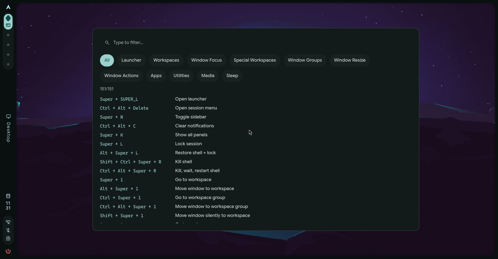
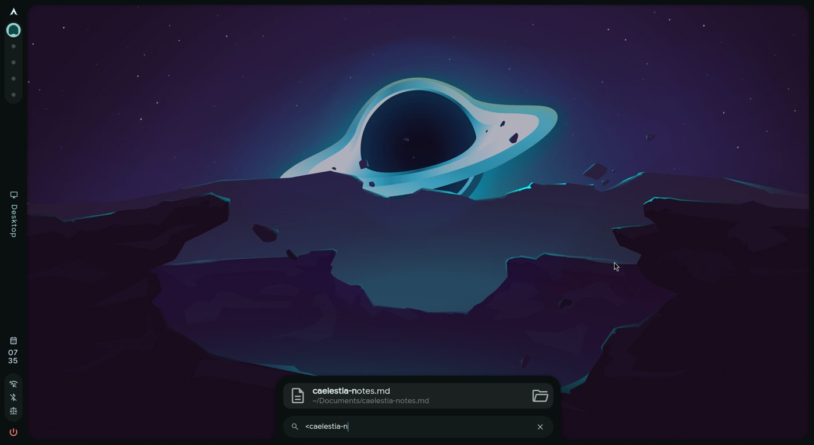

<h1 align=center>caelestia-XTend</h1>

<p align=center>Extra features for the <a href="https://github.com/caelestia-dots/shell">caelestia</a> shell, added to your existing setup with one installer.</p>

XTend is a fork of [caelestia-dots/shell](https://github.com/caelestia-dots/shell). You don't
replace your shell with it: `install.py` adds the features you pick to the caelestia you already
have, and can take them out again. The original caelestia README is in
[`README.caelestia.md`](README.caelestia.md).

## Features

| Feature | What it does | How to use it |
|---|---|---|
| **Keybind cheatsheet** | Searchable list of your Hyprland keybinds, grouped by category | `Super + /` |
| **Launcher file search** | Find files and folders in your home folder (fuzzy: `mypres` finds `my_presentation.pptx`), open them or their folder | Type `<` in the launcher |
| **Google search + Exa preview** | Search Google from the launcher; optional AI answer preview | Type `?` in the launcher |
| **Wi-Fi hotspot + QR code** *(experimental)* | Hotspot toggle, connected devices and a QR code to join, in the network popout | Bar → network icon |

<p align=center>
  
  
  
</p>

## Requirements

- **caelestia-shell 2.5.0** (the AUR package). Other versions may work: the installer checks
  every change first and skips any feature that doesn't fit.
- **Hyprland** with either caelestia's dotfiles or your own config (Lua or `hyprland.conf`).
- **Python 3** (already there if you have `caelestia-cli`).
- An AUR helper (`paru` or `yay`) for the hotspot's `create_ap`.

## Install

```sh
git clone https://github.com/YVKartikeya9/caelestia-shell-XTend
cd caelestia-shell-XTend
./install.py
```

It shows what it will do and asks before changing anything. Useful options:

```sh
./install.py --check                               # show the plan, change nothing
./install.py --features cheatsheet,filesearch      # skip the menu
./install.py --remove filesearch                   # remove one feature
./install.py --uninstall                           # remove everything XTend added
./install.py --update                              # re-apply after caelestia-shell updates
./install.py --restart                             # restart the shell (if a restart was skipped)
```

Feature names: `cheatsheet`, `filesearch`, `google`, `hotspot`. Add `--noconfirm` to accept
every default.

## What the installer changes

Nothing happens before you confirm, and everything is undone by `--uninstall`.

- **Shell files.** If your shell runs from the package (`/etc/xdg/quickshell/caelestia`), XTend
  copies it to `~/.config/quickshell/caelestia` and edits the copy. Every edit sits next to an
  unchanged upstream line and is marked with an `xtend:<feature>` comment. After a
  `caelestia-shell` update, run `./install.py --update` so the copy picks up the new version.
- **Backups.** The shell is backed up to `~/.local/state/caelestia/xtend-backups/` before
  every change. If the shell fails to load afterwards, the installer rolls back automatically.
- **Packages.** `plocate` and `fd` (file search), `qrencode`, `dnsmasq`, `iptables` and `create_ap`
  (hotspot), via
  `pacman` and your AUR helper. The daily file index (`plocate-updatedb.timer`) is turned on.
  Building `create_ap` asks to import its author's PGP key; that's expected, answer yes.
- **Settings.** Hotspot name/password and the Exa key go in `~/.config/caelestia/.env`, readable
  only by you. Uninstalling keeps this file.
- **Keybinds.** `Super + /` goes in a marked block in `~/.config/caelestia/hypr-user.lua`
  (caelestia's dotfiles), or in `~/.config/hypr/xtend.lua` loaded from your own config. A key
  that's already taken is left alone. With your OK, the installer also adds descriptions to your
  existing keybinds so the cheatsheet can show them (`scripts/describe-keybinds.py`, with a
  `.xtend-bak` backup).
- **Shell restart.** Every running caelestia shell is restarted, and its log checked for errors.
  While the installer runs it keeps your screen from locking (caelestia's idle inhibitor), and
  it never restarts the shell while the screen is locked: it waits for you to unlock first.

What was installed is recorded in `~/.config/caelestia/xtend.json`.

## Feature notes

### Wi-Fi hotspot (experimental, off by default)

The hotspot runs `create_ap`, `ip` and `iw` as root through `sudo`. **XTend doesn't set up that
root access for you**, and you shouldn't give your user password-free `sudo` for those tools:
`ip` in particular can be used to get a full root shell. A small, locked-down helper is planned.
Until then, only enable the hotspot if you know how you'll handle this.

Set the name and password in `~/.config/caelestia/.env`:

```sh
HOTSPOT_SSID="my-hotspot"
HOTSPOT_PASS="8 to 63 characters"
```

### Google search and the Exa preview

`?` always works as a Google search. The AI answer preview only runs if you add an
[Exa](https://exa.ai) API key to `~/.config/caelestia/.env` as `EXA_API_KEY="..."`. When it's
set, what you type after `?` is sent to `api.exa.ai`.

### File search

Results come from `plocate`'s index (updated daily) plus a live `fd` search, limited to your home
folder. Matching is fuzzy but in order: the letters you type must appear in the name in the same
order, with anything in between, so `report2026` finds `report_2026_final.pdf` but `hi_hello`
doesn't find `hello_hi.txt`. Exact and substring matches rank first. Caches, dependency folders
(`.cache`, `node_modules`, `__pycache__`, `.venv`, `venv`, `site-packages`, `.git`) and app data
(Trash, Steam, `~/.vscode`, Brave's profile) are left out.

## Fresh caelestia installs: known problems

These are upstream issues, not XTend's, but you'll likely hit them on a new system:

- **`caelestia install` fails with "pipewire-jack and jack2 are in conflict".** Installing
  `caelestia-cli` first can pull in `jack2`. Run `sudo pacman -S pipewire-jack` (accept
  replacing `jack2`) before `caelestia install`.
- **The Quickshell build hangs while cloning.** Its git server (`git.outfoxxed.me`) is sometimes
  unreachable. Point the `quickshell-git` PKGBUILD's source at the official GitHub mirror,
  `https://github.com/quickshell-mirror/quickshell.git`, and build again.

## Development

The edits each feature makes are defined in [`xtend/features.py`](xtend/features.py) and applied
by [`xtend/engine.py`](xtend/engine.py). This branch's edited files are generated from that, so
the branch is always "caelestia v2.5.0 + every feature".

```sh
python3 tests/test_edits.py
```

checks every combination and install order of features against clean v2.5.0: everything
installs, the QML stays valid (needs Qt 6's `qmlformat`), removing restores upstream byte for
byte, and the branch matches the installer's output.

## License

GPL-3.0, like caelestia (see [LICENSE](LICENSE)). This is a modified version of
[caelestia-dots/shell](https://github.com/caelestia-dots/shell) v2.5.0, changed from
October 2026 onwards. Upstream files that XTend edits are listed in `xtend/features.py`, and
every edit in them is marked `xtend:<feature>`. All credit for caelestia itself goes to its
authors.
